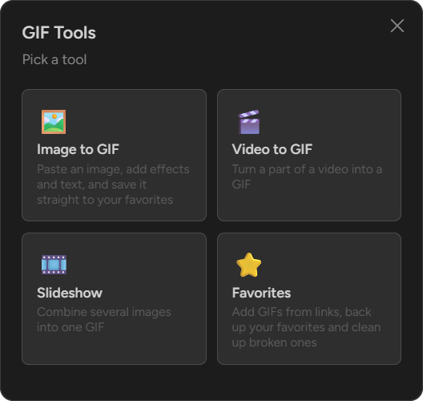
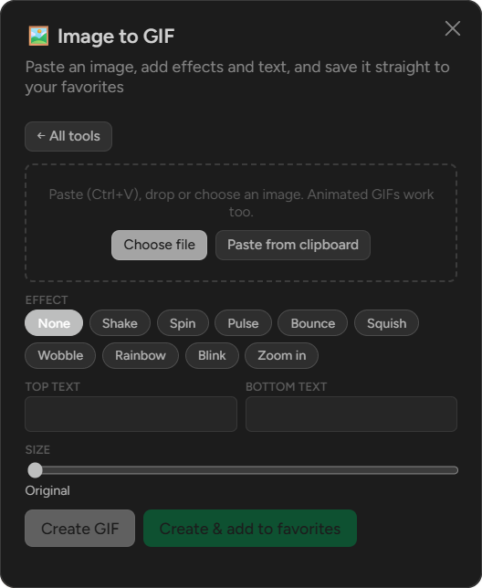
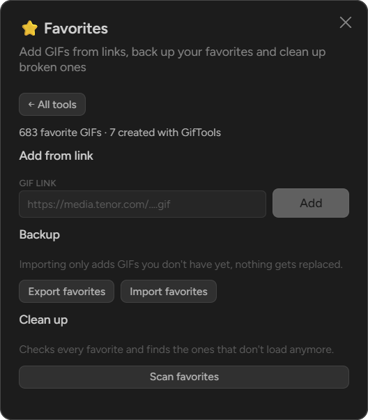
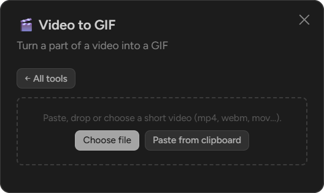
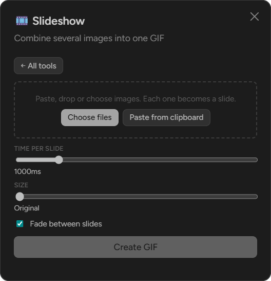

# GifTools

A [Vencord](https://github.com/Vendicated/Vencord) userplugin that adds a set of GIF tools to Discord. Type `/giftools` to open the tool menu: paste an image, turn it into a GIF and save it straight to your favorite GIFs, or make GIFs from videos and several images, and keep your favorites in order.

  

<table>
  <tr>
    <td align="center" valign="top" width="50%">
      
       <b>Image to GIF</b> Effects, captions and size, then save it to your favorites
    </td>
    <td align="center" valign="top" width="50%">
      
       <b>Favorites</b> Add from a link, back up, import and clean up
    </td>
  </tr>
  <tr>
    <td align="center" valign="top" width="50%">
      
       <b>Video to GIF</b> Turn a part of a video into a GIF
    </td>
    <td align="center" valign="top" width="50%">
      
       <b>Slideshow</b> Combine several images into one GIF
    </td>
  </tr>
</table>

## Tech stack

- TypeScript and React, built with Vencord's esbuild setup
- Vencord's plugin APIs: slash commands, settings, context menus
- [gifenc](https://github.com/mattdesl/gifenc) for encoding (already a Vencord dependency) and the browser's WebCodecs `ImageDecoder` for reading animated images
- Plain CSS, no extra dependencies

## Features

- **Image to GIF** – paste (`Ctrl+V`), drop or choose an image and save it to your favorites in one click. Animated GIFs work too and keep their frames.
- **Effects and text** – shake, spin, pulse, bounce, squish, wobble, rainbow, blink and zoom, top and bottom meme captions, size, speed and reverse.
- **Video to GIF** – pick the start and end of a video, the frame rate and the size.
- **Slideshow** – combine several images into one GIF, with an optional fade between them.
- **Favorites** – add GIFs from a link, back up your favorites to a file and import them again, and find favorites that don't load anymore. Expired Discord links are refreshed instead of removed.
- **Message context menu** – right click a message with an image or video to turn it into a GIF, open it in the editor with an effect, or make a slideshow from all of its images.

## How favoriting works

Discord only stores links in your favorite GIFs, so a GIF made with GifTools is first uploaded to a channel you choose, and the link of that upload is added to your favorites. Use a channel only you can see, such as one in your own private server.

Discord sends a favorite GIF as a link, and shows links in chat at most 400×300, smaller than the 550×350 it allows for files. So when you pick a GIF made with GifTools in the GIF picker, it is sent as a file instead and shows as big as the original image. This can be turned off in the plugin settings.

## Usage

Clone this repository into `src/userplugins/gifTools` of a Vencord checkout, build Vencord and enable **GifTools** in the plugin settings.

Set the **storage channel** in the plugin settings, or press **Use current channel** the first time you favorite a GIF. Then type `/giftools` in any chat, or right click a message with an image or video and open the **GifTools** submenu.

Other settings: the default GIF size (the original size by default, up to 1024px) and frame delay, the maximum file size (bigger GIFs are shrunk automatically), and an option to turn pasted images into favorites right away.

## License

[GPL-3.0-or-later](LICENSE). You may use, modify and fork this plugin, but copies and forks have to stay under the same license, keep the copyright notices and credit the original author. You may not present it as your own work.
